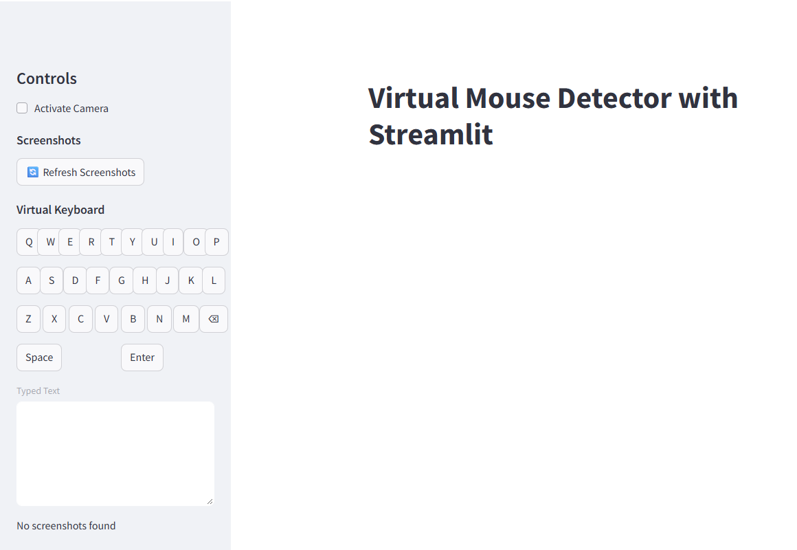

# 🖱️ Virtual Mouse: Hand-Gesture Control



<!-- To show gestures, record a short GIF with your webcam and save it as images/demo.gif -->

Control your computer's mouse with hand gestures through a webcam, with no touch needed. Built with Python, MediaPipe and OpenCV, with a Streamlit interface. Screenshots taken by gesture are uploaded to Cloudinary automatically.

**Portfolio:** [syedahafsa135.github.io](https://syedahafsa135.github.io)

---

## Problem

Traditional input devices aren't always practical. Touchless control helps in hygiene-sensitive settings and for accessibility. **Can a plain webcam and software alone replace the mouse for everyday actions?**

## Data

Live webcam frames. There is no training set: hand landmarks come from MediaPipe's pretrained hand model.

## Method

1. **Hand tracking:** MediaPipe Hands finds 21 landmarks on one hand in each webcam frame.
2. **Geometry:** `util.py` measures the angles at finger joints and the distance between thumb and index finger.
3. **Gesture rules:** those angles, distances and a raised-finger count are mapped to mouse actions, with a short delay so one gesture doesn't fire repeatedly.
4. **Action:** PyAutoGUI and pynput move the cursor, click, scroll or take a screenshot.

## Results: gesture map

| Gesture | Action |
|---|---|
| Thumb close to index finger, index finger straight | Move cursor |
| Index finger bent | Left click |
| Middle finger bent | Right click |
| Index and middle fingers bent | Double click |
| Index and middle fingers bent, thumb close | Screenshot, uploaded to Cloudinary |
| 3 fingers raised | Scroll up |
| 4 fingers raised | Scroll down |

The sidebar also has an on-screen **virtual keyboard** and a gallery of saved screenshots.

## How to run

```bash
git clone https://github.com/syedahafsa135/VirtualMouse.git
cd VirtualMouse
python -m venv venv
venv\Scripts\activate          # on Mac/Linux: source venv/bin/activate
pip install -r requirements.txt
```

Add your Cloudinary credentials to `.streamlit/secrets.toml`. Never commit this file.

```toml
cloud_name = "your-cloud-name"
api_key = "your-api-key"
api_secret = "your-api-secret"
```

Then start the app and tick **Activate Camera** in the sidebar:

```bash
streamlit run streamlit_app.py
```

It needs a webcam and must run on your own computer, because it controls your local mouse.

## Limitations

- Runs only on your own computer with a webcam, because it controls the local mouse.
- Gestures are fixed angle and distance rules; recognition accuracy hasn't been measured on a test set yet.

## Project structure

```
├── streamlit_app.py      # app: camera feed, gesture detection, mouse actions, keyboard
├── util.py               # angle and distance helpers
├── cloudinary_utils.py   # screenshot upload
└── requirements.txt
```

## Tech stack

Python · MediaPipe · OpenCV · PyAutoGUI · pynput · Streamlit · Cloudinary
